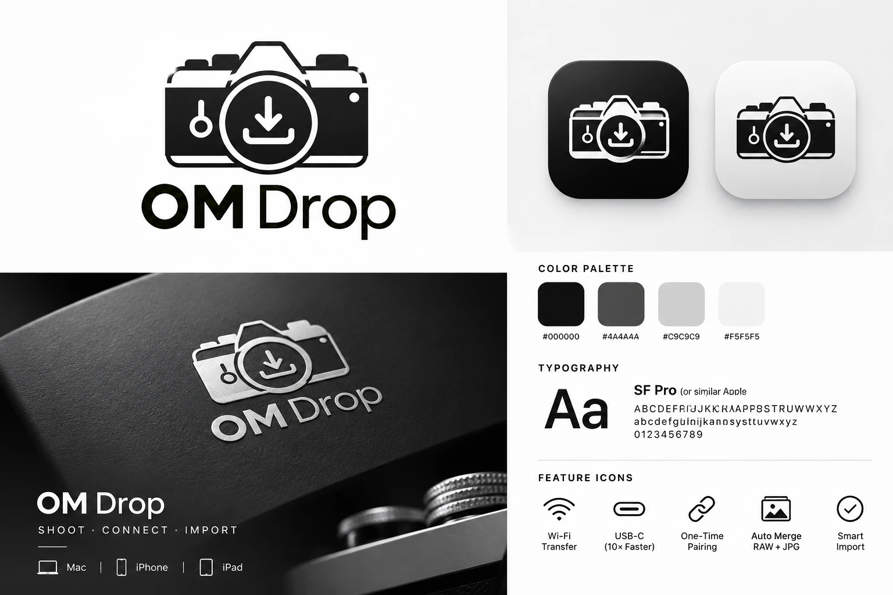

# OM Drop 品牌識別（CIS）

**OM Drop — Shoot · Connect · Import**

把 OM 相機的照片快速帶到 Mac、iPhone、iPad。品牌語氣：安靜、精準、像工具一樣可靠。視覺只用黑、白、灰，讓照片本身成為主角。



## 1. 標誌

標誌是一台經典單眼相機，鏡頭換成「下載」符號：拍攝（相機）＋匯入（箭頭）。

| 檔案 | 用途 |
|---|---|
| `logo-mark-black.png` | 淺色背景上的標誌（透明背景） |
| `logo-mark-white.png` | 深色背景上的標誌（透明背景） |
| `lockup-stacked-*.png` | 直式組合：標誌＋字標＋標語，用於啟動畫面、海報 |
| `lockup-horizontal-*.png` | 橫式組合：標誌＋字標，用於網站頁首、README |
| `app-icon-light.png` / `app-icon-dark.png` / `app-icon-macos.png` | App 圖示預覽 |

`*-black` 用於淺色背景，`*-white` 用於深色背景，`*-on-dark` 是已含黑色底的版本。

**留白**：標誌四周至少保留「鏡頭圓圈直徑的一半」。
**最小尺寸**：標誌寬 24 pt；含字標的組合寬 96 pt。
**不要**：改變比例、加外框或陰影、旋轉、改成黑白以外的顏色、把箭頭換成其他符號。

## 2. 字標

`OM` 用 **SF Pro Heavy**，`Drop` 用 **SF Pro Regular**，中間一個空格，字距 −1%。名稱寫作「OM Drop」，不寫成 OMDrop、Om Drop 或 OM-Drop（GitHub repo 名稱除外）。

## 3. 顏色


| 名稱 | 色碼 | 用途 |
|---|---|---|
| Ink | `#000000` | 標誌、主要文字、淺色模式的主按鈕（介面上用 `#1C1C1E`） |
| Graphite | `#4A4A4A` | 次要文字、深色模式的主按鈕 |
| Silver | `#C9C9C9` | 分隔線、停用狀態、深色底上的標語 |
| Paper | `#F5F5F5` | 淺色背景、深色模式的強調色 |

只有狀態提示可以使用系統色：已匯入（綠）、警告（橘）、錯誤（紅）、連線中（橘點）。

## 4. 字體

Apple 平台一律使用系統字體 **SF Pro**（中文自動使用蘋方）。

| 層級 | 字重 |
|---|---|
| 標題 | Semibold / Bold |
| 內文 | Regular |
| 標語 | Medium，全大寫，字距加寬（SHOOT · CONNECT · IMPORT） |

## 5. App 圖示

| 平台 | 樣式 |
|---|---|
| iPhone / iPad 淺色 | 白到淺灰漸層底、黑色標誌 |
| iPhone / iPad 深色 | 深灰到黑漸層底、白色標誌 |
| iPhone / iPad 染色 | 黑底白色標誌，由系統上色 |
| macOS | 黑色圓角方形（Apple 1024 格線，主體 824 px）、白色標誌、柔和陰影 |

標誌寬度約為圖示寬度的 70%（macOS 為主體的 70%）。

## 6. 功能圖示

介面使用 SF Symbols，線條風格和標誌一致：

| 功能 | Symbol |
|---|---|
| Wi-Fi 傳輸 | `wifi` |
| USB-C（快 10 倍以上） | `cable.connector` |
| 一次配對 | `qrcode.viewfinder` |
| RAW+JPG 自動合併 | `camera.aperture` |
| 聰明匯入（不重複） | `checkmark.circle` |

## 7. 重新產生素材

所有 PNG 與 App 圖示都由腳本從 `source/logo-mark-source.webp` 產生：

```bash
swift tools/brand/make_brand.swift
```

腳本也會寫入 `App/Shared/Assets.xcassets`（App 圖示、App 內標誌、強調色）。
