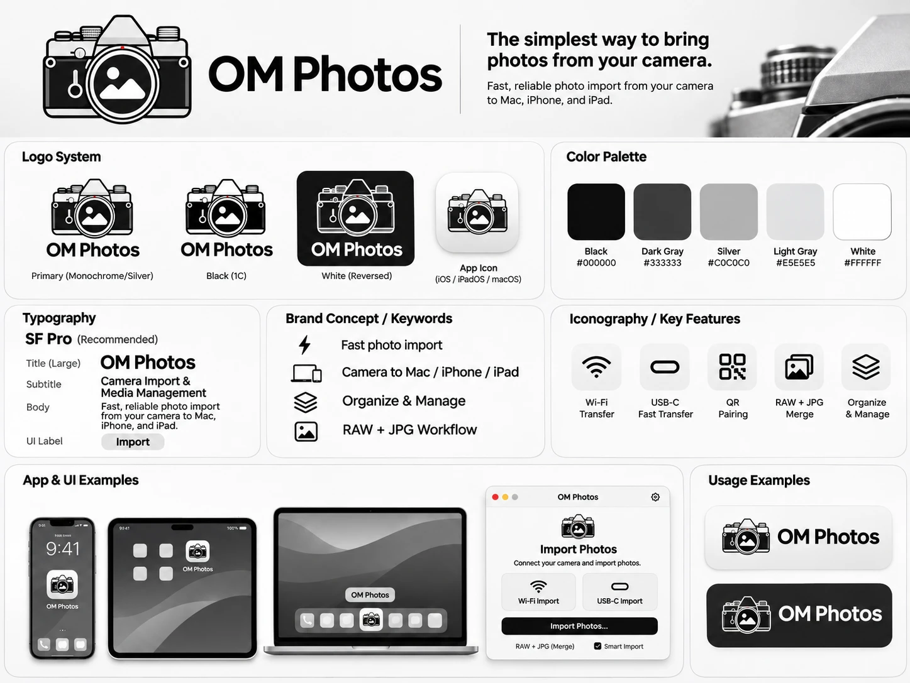
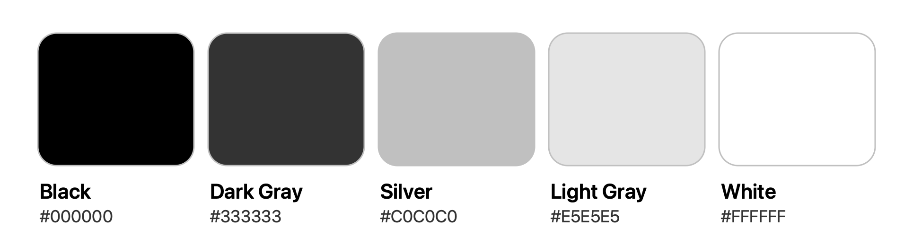

# OM Photos 品牌識別（CIS）

**OM Photos — The simplest way to bring photos from your camera.**
Camera Import & Media Management：把相機裡的照片快速、可靠地帶到 Mac、iPhone、iPad。



## 1. 品牌概念

| 關鍵字 | 意思 |
|---|---|
| Fast photo import | 快速匯入 |
| Camera to Mac / iPhone / iPad | 相機到三種裝置 |
| Organize & Manage | 整理與管理（篩選、刪除） |
| RAW + JPG Workflow | RAW 和 JPG 合併處理 |

視覺以黑、銀、白為主，唯一的彩色是鏡頭上緣的紅點，讓照片本身成為主角。

## 2. 標誌

一台經典機械相機，鏡頭裡是「照片」符號（太陽與山）：相機 ＋ 照片。

| 版本 | 檔案 | 用途 |
|---|---|---|
| Primary（單色/銀） | `logo-mark-primary.png`、`lockup-*-primary.png` | 淺色背景（預設） |
| Black（1C） | `logo-mark-black.png`、`lockup-*-black.png` | 單色印刷、淺色背景 |
| White（Reversed） | `logo-mark-reversed.png`、`lockup-*-reversed.png` | 黑底，標誌外圍加銀色邊 |

`lockup-stacked-*` 是直式組合（標誌＋名稱＋標語），`lockup-horizontal-*` 是橫式組合。

**留白**：標誌四周至少保留鏡頭圓圈直徑的四分之一。
**最小尺寸**：標誌寬 32 pt（更小時細節看不清楚）；含名稱的組合寬 120 pt。
**不要**：改變比例、旋轉、加陰影、改配色、拿掉紅點、在深色背景使用沒有銀邊的版本。

## 3. 字標

名稱寫作「**OM Photos**」，整個字標用 **SF Pro Bold**，字距 −1.5%。程式碼識別字和 repo 名稱寫作 `OMPhotos`、`OM-Photos`。

## 4. 顏色



| 名稱 | 色碼 | 用途 |
|---|---|---|
| Black | `#000000` | 主要文字、淺色模式強調色與主按鈕 |
| Dark Gray | `#333333` | 次要文字、深色模式主按鈕、深色圖示底色 |
| Silver | `#C0C0C0` | 深色背景上的標誌外邊、分隔線 |
| Light Gray | `#E5E5E5` | 淺色背景、深色模式強調色 |
| White | `#FFFFFF` | 背景、深色模式文字 |

狀態提示可使用系統色：選取（藍）、已匯入（綠）、警告（橘）、錯誤與刪除（紅）。

## 5. 字體

Apple 平台使用系統字體 **SF Pro**（中文自動使用蘋方）。

| 層級 | 字重 | 範例 |
|---|---|---|
| Title (Large) | Bold | OM Photos |
| Subtitle | Semibold | Camera Import & Media Management |
| Body | Regular | Fast, reliable photo import from your camera… |
| UI Label | Semibold | 匯入 |

## 6. App 圖示

| 平台 | 樣式 |
|---|---|
| iPhone / iPad 淺色 | 白到淺灰漸層底、彩色標誌 |
| iPhone / iPad 深色 | 深灰到黑漸層底、標誌加銀邊 |
| iPhone / iPad 染色 | 黑底、灰階標誌加銀邊，由系統上色 |
| macOS | 白到淺灰的圓角方形（Apple 1024 格線，主體 824 px）、柔和陰影 |

標誌寬度為圖示的 78%（macOS 為主體的 80%）。

## 7. 功能圖示

介面使用 SF Symbols：

| 功能 | Symbol |
|---|---|
| Wi-Fi Transfer | `wifi` |
| USB-C Fast Transfer | `cable.connector` |
| QR Pairing | `qrcode.viewfinder` |
| RAW + JPG Merge | `photo.on.rectangle` |
| Organize & Manage | `line.3.horizontal.decrease` |

## 8. 重新產生素材

所有 PNG 與 App 圖示都由腳本從 `source/logo-mark-source.webp` 產生（自動去背）：

```bash
swift tools/brand/make_brand.swift
```

腳本也會寫入 `App/Shared/Assets.xcassets`（App 圖示、App 內標誌、強調色）。
